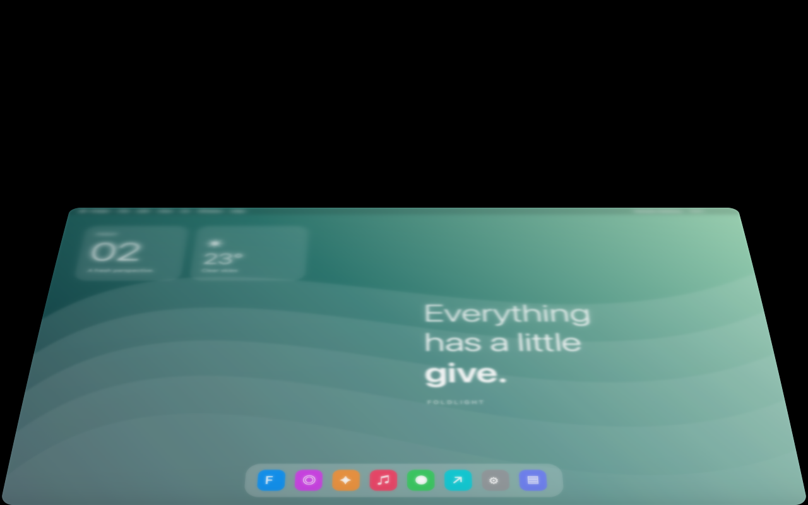

# Foldlight

A macOS menu bar app that folds your MacBook desktop as you lower the lid, then unfolds it as you open it.



Version 1.2 adds a more gradual three-stage blur, gentle motion-aware softness, cleaner glass reflections, and smoother closing and reopening. Blur layers run at half resolution while the sharp desktop stays native Retina. Capture and lid sampling follow supported displays up to 120 Hz.

[Watch the 1.2 preview](https://github.com/leotsuka1/Foldlight/releases/download/v1.2.0/Animation.mp4) · [Download the latest app](https://github.com/leotsuka1/Foldlight/releases/latest)

## Install

1. Download **Foldlight-1.2.0.zip** from the latest release, unzip it, and move **Foldlight.app** to Applications.
2. Try **Preview the fold** to see the eight-second demo.
3. For the live lid effect, allow Foldlight in **System Settings → Privacy & Security → Screen & System Audio Recording**. Quit and reopen the app if macOS asks.
4. Leave **Respond to the lid** on and set the threshold below your usual lid angle.

Foldlight runs in the menu bar, records no audio, writes no screen images, and makes no network requests. Desktop frames stay in memory. The app does not change sleep behavior or run at login.

## Requirements

- macOS 14 or later, Metal, and a MacBook with a readable lid-angle sensor.
- This prebuilt version is for Apple Silicon, locally signed, and not notarized.
- Screen recording permission for the live desktop effect; the preview works without it.

## Build and verify

Install Apple’s command-line developer tools, then run from the repository root:

```sh
cd Source
zsh scripts/build.sh
```

Run checks from the repository root with:

```sh
Foldlight.app/Contents/MacOS/Foldlight --self-test
Foldlight.app/Contents/MacOS/Foldlight --capture-regression
```

The capture check requires screen recording permission.

## 1.2 performance

On the development Mac’s M2, average GPU time for live 3024×1964 frames fell from 5.64 ms in 1.1.1 to 2.68 ms in 1.2.0. Results depend on hardware. Automated optical, motion, and closed-settings capture checks pass.

## Credits

Built with Apple’s ScreenCaptureKit and Metal. Sensor protocol reference: [samhenrigold/LidAngleSensor](https://github.com/samhenrigold/LidAngleSensor). Animation inspiration: [Foldlight’s video reference](https://www.youtube.com/watch?v=u1upGj9W7jA) and [Sean’s iPhone Duo transition](https://x.com/SeanJamshidi/status/2097752953507483969).
